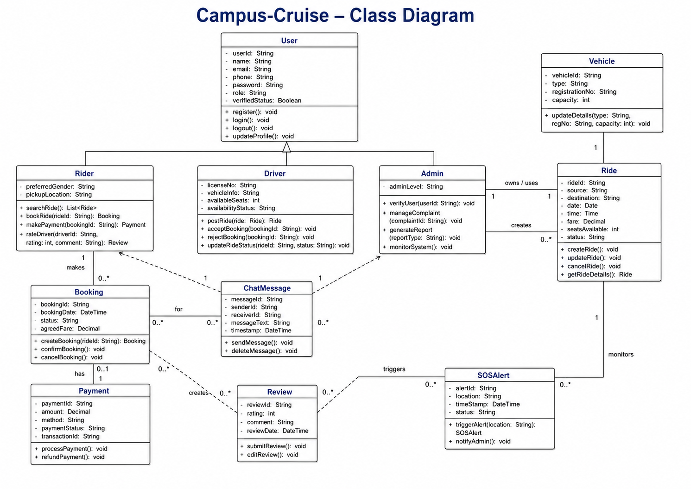

# 🚗 Campus-Cruise

**A verified, students-only ride-sharing platform for United International University (UIU).**
Student drivers post rides, student riders book them, and everyone stays inside a trusted campus community.

> Course project for **System Analysis & Design Laboratory (CSE 3411)**, UIU, with a full SRS, system models, and a Figma UI prototype (mobile + web).

## Why Campus-Cruise?

Commuting to campus is expensive, slow and sometimes unsafe. Commercial apps such as Uber and Pathao don't offer the trust of travelling with verified classmates. Campus-Cruise connects UIU students who own vehicles with students heading the same way, at fair prices.

## Key features

- **Verified access only**: UIU email registration, student ID check, driving-licence check for drivers, admin approval before activation
- **Ride posting and search**: pickup, destination, schedule, seats and fare; filter by route and time
- **Driver-approved bookings**: every request is accepted or rejected by the driver
- **Smart matching**: suggests rides from route similarity and uploaded class routines
- **In-app chat and fare negotiation**
- **Payments**: bKash, Nagad or cash
- **Live GPS tracking and Emergency SOS**
- **Ratings and reviews** for riders and drivers
- **Complaints and admin dashboard**: verification, moderation, suspension and bans

## Platforms (prototype)

| Surface | Users |
|---|---|
| Mobile app | Rider, Driver |
| Web portal | Rider, Driver |
| Admin web panel | Administrators |

## Planned tech stack (from the SRS)

Flutter / React Native (mobile) · HTML5, CSS3, JavaScript (web) · Node.js + Express REST APIs · MySQL / PostgreSQL (Firebase optional) · Google Maps · bKash / Nagad gateways · push and email notifications. Process model: **Agile**.

## Documentation

| Document | Location |
|---|---|
| Software Requirements Specification | [`docs/srs/Campus-Cruise_SRS.pdf`](docs/srs/Campus-Cruise_SRS.pdf) |
| Proposal presentation | [`docs/presentations/Presentation_01_Proposal.pptx`](docs/presentations/Presentation_01_Proposal.pptx) |
| Feasibility and analysis presentation | [`docs/presentations/Presentation_02_F_Analysis.pptx`](docs/presentations/Presentation_02_F_Analysis.pptx) |

The SRS covers requirements elicitation (survey of UIU students, Uber/Pathao benchmarking, MoSCoW prioritisation), 16 functional requirement groups, non-functional requirements, feasibility and SWOT analysis, system diagrams and the prototype design.

## System design

| Data Flow Diagram | Use Case Diagram |
|---|---|
|  |  |

| Class Diagram | Ride Booking Sequence |
|---|---|
|  |  |

## Figma prototype

🎨 **Prototype link:** _add the Figma share link here_

Screens are documented in section 8 of the SRS (mobile rider/driver, web rider/driver/admin).

## Team

- Nafis Iqbal Neloy
- Abdullah Al Muhaimin
- Jannatul Ferdous
- Nazifa Akter
- Israt Jahan Sukonna

Submitted to **Sidratul Muntaha**, Lecturer, Dept. of CSE, UIU, on 11 June 2026.
